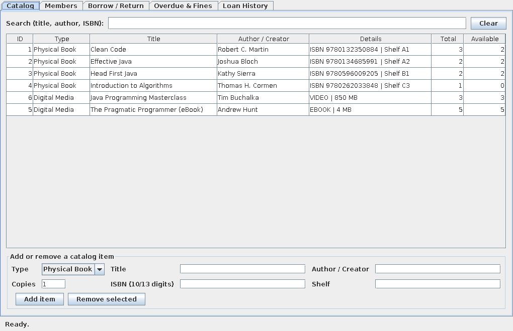
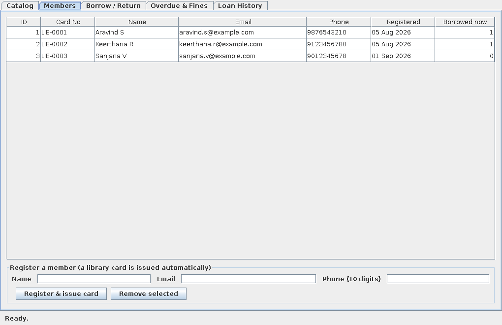
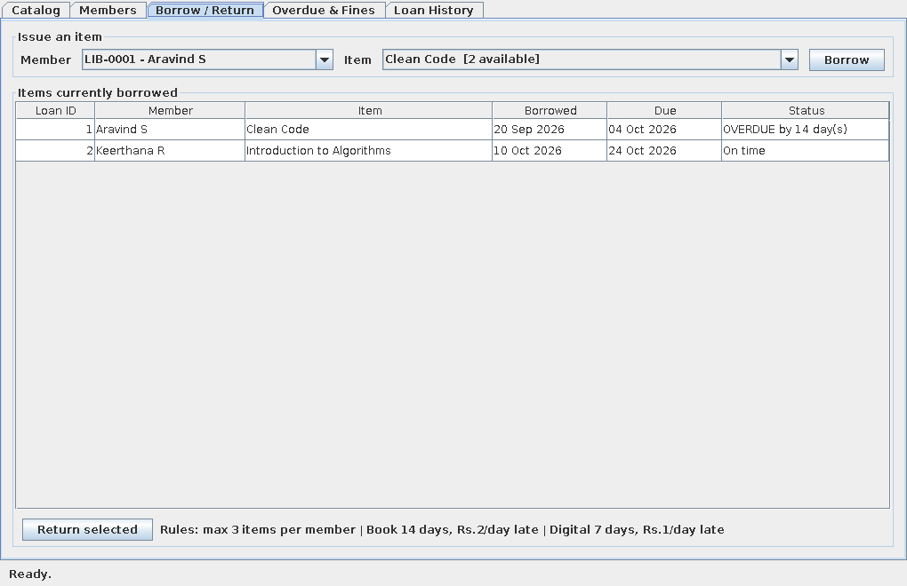
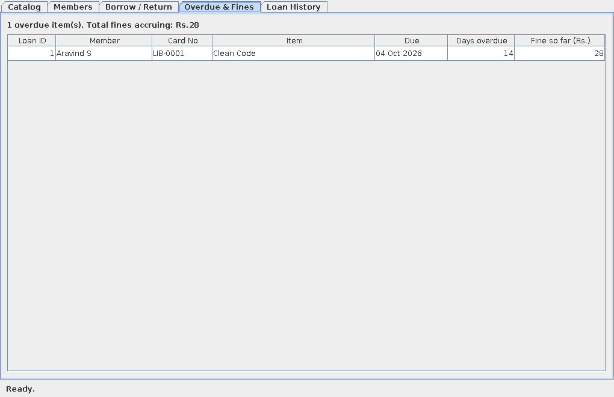
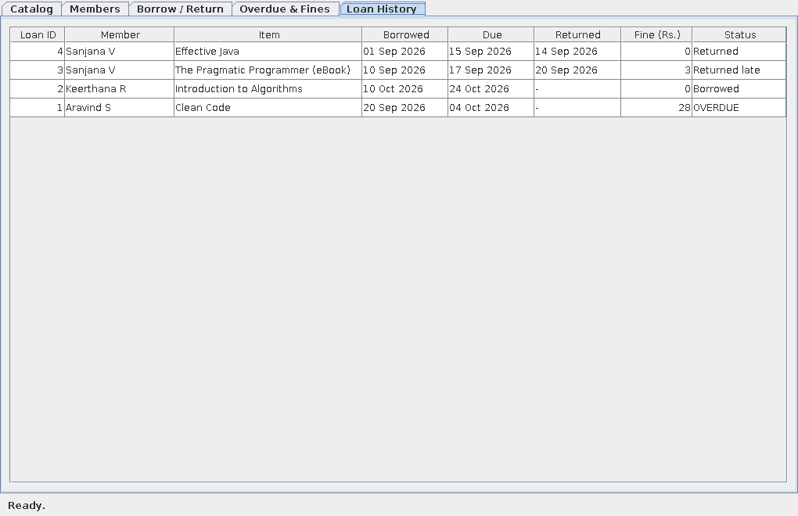

# Library Management System (Java)

CodeNova Java Programming Internship, Batch 01 - **Task 3**.

A desktop (Java Swing) application to manage a library: catalog of physical books and digital
media, member registration with library-card issuing, borrow / return tracking, overdue flagging
and fine calculation. Data is stored in CSV files with relational integrity enforced in code.

**Demo video:** PASTE_YOUR_DEMO_LINK_HERE

## Features
- **Catalog management** - add and remove physical books and digital media (e-book, audiobook, video), live search by title / author / ISBN
- **Members** - register a member, a library card number (`LIB-0001`...) is issued automatically; email, phone (10 digits) and duplicates are validated
- **Borrow / return lifecycle** - due date is set automatically, returning shows any fine
- **Overdue flagging and fines** - overdue items are highlighted, fines accrue per late day
- **Persistent storage** - everything is saved to CSV files in `data/` and reloaded on start-up
- **Custom business exceptions** - `BookNotAvailableException`, `BorrowLimitExceededException`, `MemberBlockedException`, `IntegrityException` and more, all handled cleanly in the UI

## Business rules
| Rule | Physical Book | Digital Media |
|------|---------------|---------------|
| Loan period | 14 days | 7 days |
| Fine | Rs.2 per overdue day | Rs.1 per overdue day |

- A member can hold at most **3** items at once
- A member with an **overdue** item cannot borrow anything new until it is returned
- The same member cannot borrow the same item twice at the same time
- Fine = overdue days x the item's fine per day (0 if returned on or before the due date)

## OOP principles used
- **Encapsulation** - all model fields are private; objects change only through methods (e.g. `Loan.markReturned`)
- **Abstraction** - `LibraryItem` is an abstract class declaring `getLoanDays()`, `getFinePerDay()`, `getDetails()`; `Repository<T>` is an interface that hides how data is stored
- **Inheritance** - `PhysicalBook` and `DigitalMedia` both extend `LibraryItem`
- **Polymorphism** - `LibraryService.borrow()` and `returnItem()` call `item.getLoanDays()` / `item.getFinePerDay()` without knowing the concrete type, so each kind behaves differently

## Class diagram (description)
```
                 +--------------------+
                 | <<abstract>>       |
                 | LibraryItem        |
                 |--------------------|
                 | id, title, creator,|
                 | totalCopies        |
                 | getLoanDays()      |  abstract
                 | getFinePerDay()    |  abstract
                 +----------^---------+
                  inherits  |  inherits
          +-----------------+-----------------+
  +-------+---------+                 +-------+---------+
  | PhysicalBook    |                 | DigitalMedia    |
  | isbn, shelf     |                 | format, sizeMb  |
  | 14 days, Rs.2   |                 | 7 days, Rs.1    |
  +-----------------+                 +-----------------+

  +----------+   1      * +--------+ *      1 +--------------+
  | Member   |------------|  Loan  |-----------| LibraryItem  |
  | cardNo...|  borrows   | due,   |  is of    +--------------+
  +----------+            | fine...|
                          +--------+

  LibraryFrame (ui)  -->  LibraryService (service)  -->  Repository<T> (interface)
                                                              ^
                  ItemCsvRepository, MemberCsvRepository, LoanCsvRepository (CSV files)
```
A `Loan` links one `Member` to one `LibraryItem`. Available copies are never stored; they are
always calculated as `totalCopies - loans still out`, so the inventory always matches the
borrow and return history.

## Relational integrity
- A loan can only be created for a member and item that exist
- An item with copies on loan cannot be removed
- A member with items on loan cannot be removed
- If saving to disk fails, the in-memory change is rolled back, so memory and files never disagree

## Project structure (packages: model, service, repository, ui)
```
LibraryManagement/
  src/com/codenova/library/
    Main.java                        entry point
    model/       LibraryItem, PhysicalBook, DigitalMedia, Member, Loan
    service/     LibraryService      all business rules
    repository/  Repository<T>, ItemCsvRepository, MemberCsvRepository, LoanCsvRepository, CsvFile
    ui/          LibraryFrame        Swing window (5 tabs)
    exception/   LibraryException + 9 specific business exceptions, StorageException
  test/.../SelfTest.java             42 automated checks (no JUnit needed)
  data/        items.csv, members.csv, loans.csv   sample persistent data
  screenshots/ application screenshots
```

## Tech stack
Java 17+ (tested on 21), Swing (built into the JDK), `java.time`, Java Collections, File I/O (`java.nio.file`).
No external libraries, no paid tools. (CSV storage can be swapped for JDBC + SQLite/H2 by writing new `Repository<T>` classes; the service does not change.)

## Build and run
Requires JDK 17 or newer.

**Easiest (Windows):** double-click `run.bat` (or `LibraryManagement.jar`).

**VS Code:** open the `LibraryManagement` folder, open `src/com/codenova/library/Main.java` and click **Run**.

**Command line** - from the `LibraryManagement` folder:
```
mkdir out
javac -d out src/com/codenova/library/Main.java src/com/codenova/library/*/*.java
java -cp out com.codenova.library.Main
```
Use another data folder: `java -cp out com.codenova.library.Main mydata`

**Build the jar:**
```
echo Main-Class: com.codenova.library.Main > manifest.txt
jar cfm LibraryManagement.jar manifest.txt -C out com
java -jar LibraryManagement.jar
```

## Run the self-tests
```
javac -d out -cp out test/com/codenova/library/SelfTest.java
java -cp out com.codenova.library.SelfTest
```
Expected: `42 passed, 0 failed`. The tests use a controllable clock to check due dates, overdue
flags, fines, the borrow limit, inventory changes, relational integrity, persistence across
restarts and corrupt-file handling.

## Data files (sample persistent data)
`items.csv`
```
kind,id,title,creator,totalCopies,extra1,extra2
BOOK,1,Clean Code,Robert C. Martin,3,9780132350884,Shelf A1       (extra1 = ISBN, extra2 = shelf)
DIGITAL,5,The Pragmatic Programmer (eBook),Andrew Hunt,5,EBOOK,4  (extra1 = format, extra2 = size in MB)
```
`members.csv`: `id,cardNumber,name,email,phone,registeredOn`

`loans.csv`: `id,itemId,memberId,borrowDate,dueDate,returnDate,fine` (`returnDate` is empty while the item is out)

The sample loans use fixed dates, so one loan appears overdue to demonstrate fines.

## Screenshots
| | |
|---|---|
|  |  |
|  |  |
|  | |
